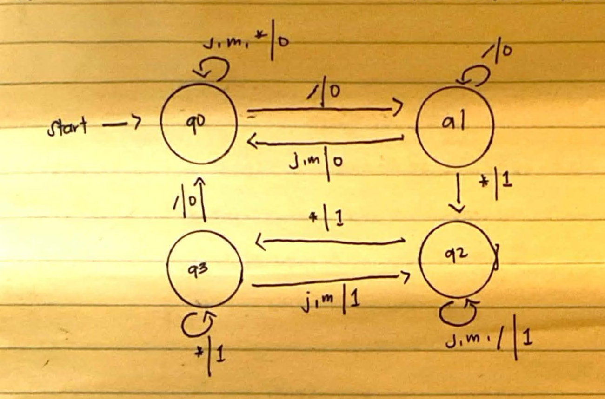

# Mealy Machine: Tracking Symbols Inside C-Style Comments

**Name: JM Marvie Brizuela**

This Mealy machine, implemented in C, labels every input symbol according to whether it falls inside a C-style comment. The inputs are `j`, `m`, `*` and `/`, with `j` and `m` representing any character that is not `*` or `/`. The outputs are the bits `0` and `1`.

Since the output is tied to the **transition**, each symbol read produces one output bit. The bit is `1` when, after reading that symbol, the machine is sitting inside a comment, and `0` when it is outside. This lets the machine work on strings that mix ordinary code with comments, including strings that contain more than one comment.

A Mealy machine has no set of final states, which means a string is not accepted or rejected the way it is in a DFA or NFA; the output string is the answer. The machine also has no trap state, because all four states define a move for every input symbol.

## States

| State | Meaning |
|-------|---------|
| q0 | start state; plain code, no comment open |
| q1 | outside a comment; a `/` was just read, so `/*` might follow |
| q2 | the machine is within a comment |
| q3 | inside a comment; a `*` was just read, so `*/` might follow |

## Formal Definition

```
M = (Q, Σ, Δ, δ, λ, q0)

Q  = { q0, q1, q2, q3 }
Σ  = { j, m, *, / }
Δ  = { 0, 1 }
q0 = q0
δ  : Q × Σ → Q        (gives the next state)
λ  : Q × Σ → Δ        (gives the output bit for each move)
```

Output rule: `λ = 1` when the machine is inside a comment after the move, and `λ = 0` when it is outside.

## State Diagram



Each arrow carries the label `input | output`.

## Transition Table

| State | δ(q,j) | λ(q,j) | δ(q,m) | λ(q,m) | δ(q,*) | λ(q,*) | δ(q,/) | λ(q,/) |
|-------|--------|--------|--------|--------|--------|--------|--------|--------|
| → q0 | q0 | 0 | q0 | 0 | q0 | 0 | q1 | 0 |
| q1 | q0 | 0 | q0 | 0 | q2 | 1 | q1 | 0 |
| q2 | q2 | 1 | q2 | 1 | q3 | 1 | q2 | 1 |
| q3 | q2 | 1 | q2 | 1 | q3 | 1 | q0 | 0 |

The arrow `→` points at the start state. For each input symbol, the first column is the state reached and the second is the bit printed.

## δ and λ Equations

```
δ(q0,j)=q0   δ(q0,m)=q0   δ(q0,*)=q0   δ(q0,/)=q1
δ(q1,j)=q0   δ(q1,m)=q0   δ(q1,*)=q2   δ(q1,/)=q1
δ(q2,j)=q2   δ(q2,m)=q2   δ(q2,*)=q3   δ(q2,/)=q2
δ(q3,j)=q2   δ(q3,m)=q2   δ(q3,*)=q3   δ(q3,/)=q0

λ(q0,j)=0    λ(q0,m)=0    λ(q0,*)=0    λ(q0,/)=0
λ(q1,j)=0    λ(q1,m)=0    λ(q1,*)=1    λ(q1,/)=0
λ(q2,j)=1    λ(q2,m)=1    λ(q2,*)=1    λ(q2,/)=1
λ(q3,j)=1    λ(q3,m)=1    λ(q3,*)=1    λ(q3,/)=0
```

## Sample Strings

| Input | Output string | Final state |
|-------|---------------|-------------|
| `jm` | `00` | q0 |
| `j/*m*/j` | `0011100` | q0 |
| `/*j*/m/*m*/` | `01110001110` | q0 |
| `/**/` | `0110` | q0 |
| `/*j/m*/` | `0111110` | q0 |
| `/*jmj*mjm*/` | `01111111110` | q0 |
| `j/m*/` | `00000` | q1 |
| `//jm` | `0000` | q0 |
| `*/j` | `000` | q0 |
| `j/*/m*/jm` | `001111000` | q0 |
| `/*j` | `011` | q2 |
| `/*/` | `011` | q2 |

Ending in q0 or q1 means the string stops outside a comment. Ending in q2 or q3 means a comment was started but never finished.

Note that the opening `/` gives `0` while the `*` right after it gives `1`, and the closing `/` gives `0`. The machine cannot tell that a `/` begins a comment until the next `*` arrives, so the first `1` appears one symbol late.

## Handwritten


